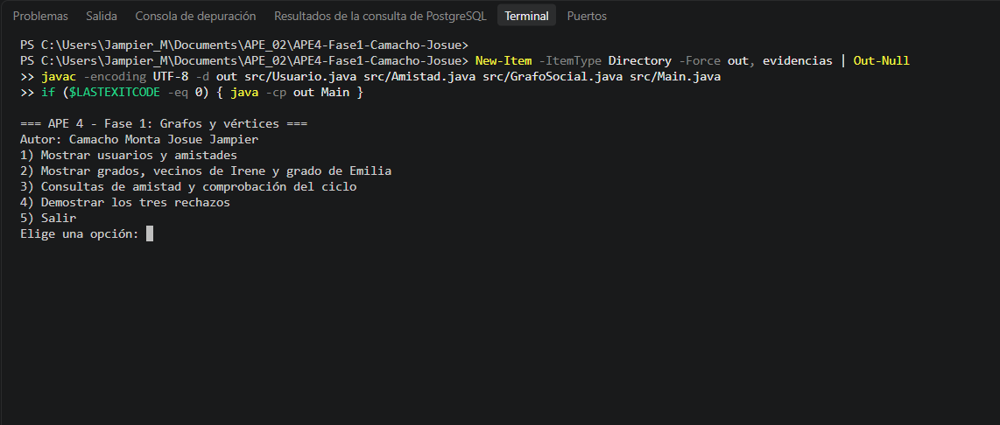
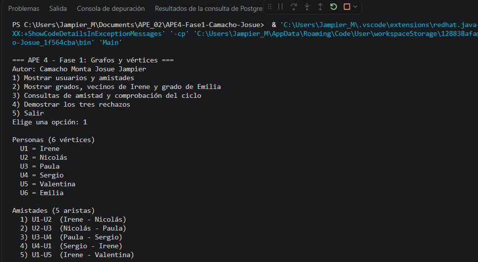
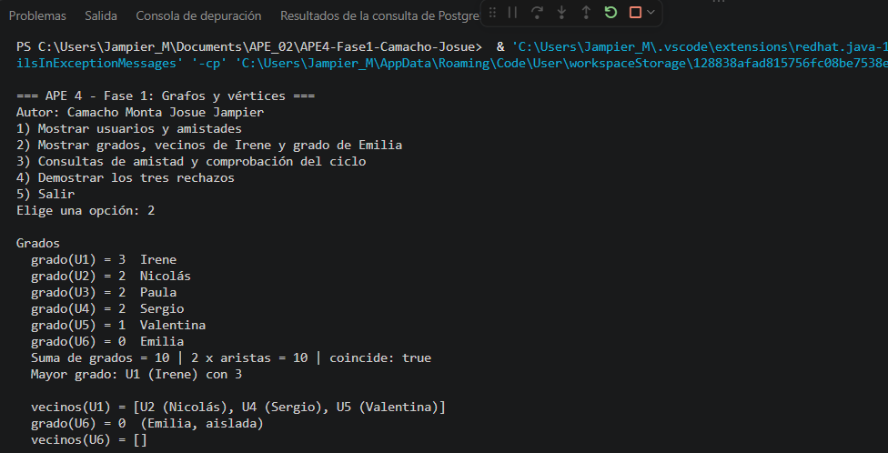
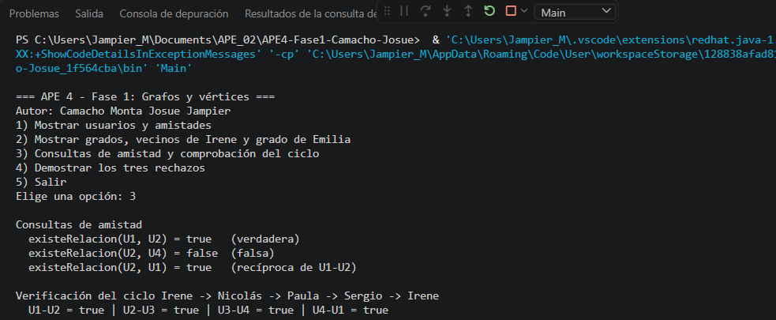
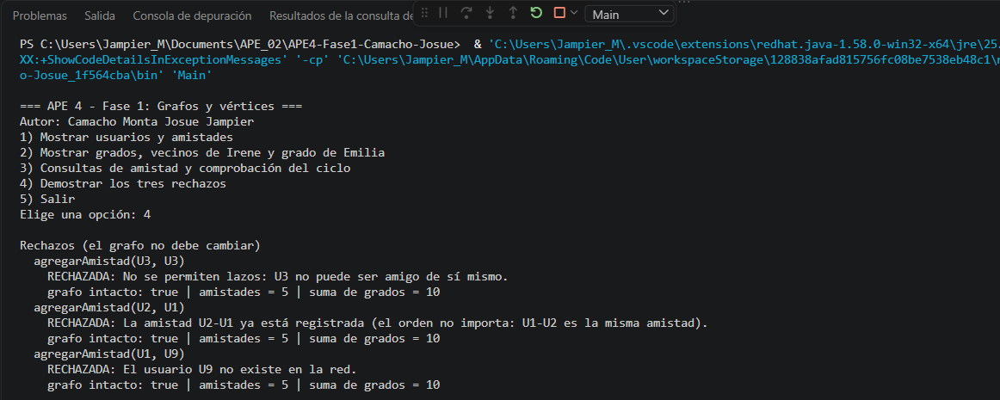

# Evidencias de ejecución del APE 4

**Fase 1 · Grafos y vértices**  
**Estudiante:** Camacho Monta Josue Jampier

## Compilación y ejecución

La Figura 1 muestra la compilación y el inicio del menú desde la raíz del repositorio en PowerShell. Las Figuras 2 a 5 muestran las opciones 1 a 4 ejecutadas mediante el botón Run de VS Code.

## Figura 1. Menú principal

La terminal muestra la compilación de las cuatro clases y el inicio de `Main`. Las opciones 1 a 4 ejecutan las consultas y validaciones. La opción 5 permite salir.

## Figura 2. Usuarios y amistades

La opción 1 lista los seis vértices y las cinco aristas. Cada amistad aparece una vez en el listado.

## Figura 3. Grados y vecinos

La opción 2 muestra que la suma de los grados es **10 = 2 × 5**. Irene tiene tres vecinos, Nicolás, Sergio y Valentina. Emilia tiene grado 0 y su conjunto de vecinos está vacío.

## Figura 4. Consultas de amistad y comprobación del ciclo

`existeRelacion(U1, U2)` devuelve `true`, `existeRelacion(U2, U4)` devuelve `false` y `existeRelacion(U2, U1)` devuelve `true`. La opción 3 comprueba las cuatro aristas del ciclo **U1 → U2 → U3 → U4 → U1**.

## Figura 5. Rechazo de amistades inválidas

La opción 4 rechaza el lazo U3–U3, la amistad duplicada U2–U1 y la amistad con el usuario inexistente U9. En los tres intentos la salida indica `grafo intacto: true`, cinco amistades y suma de grados 10.
