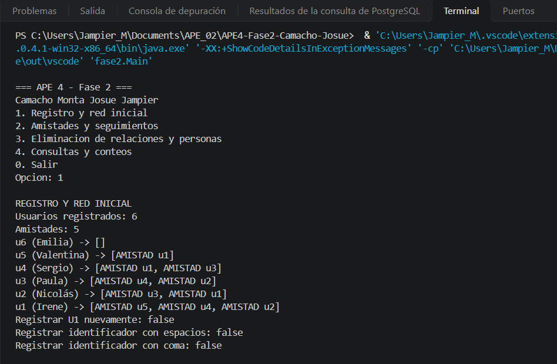
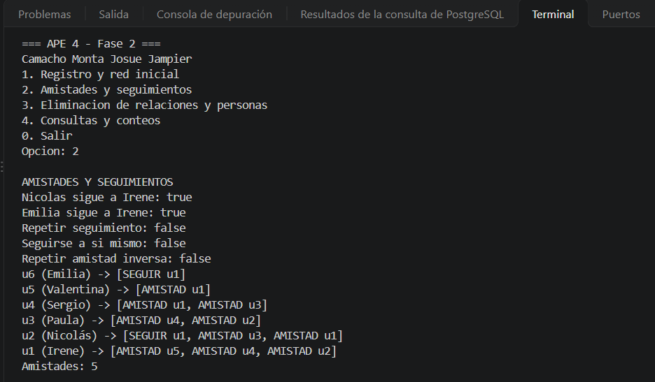
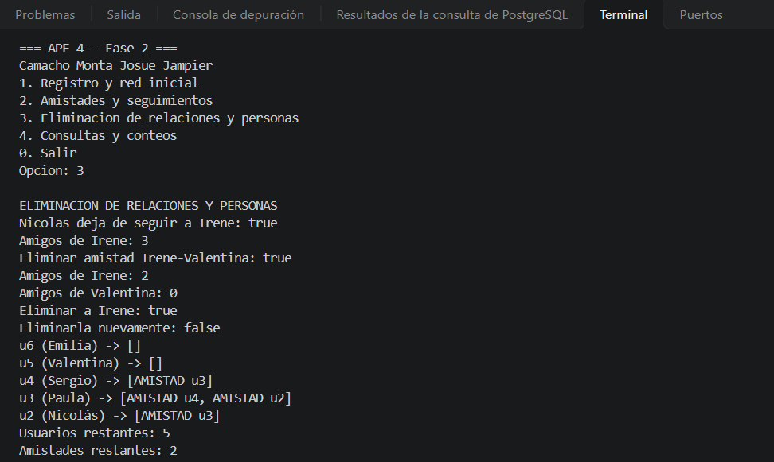
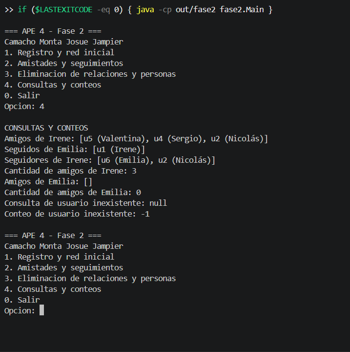
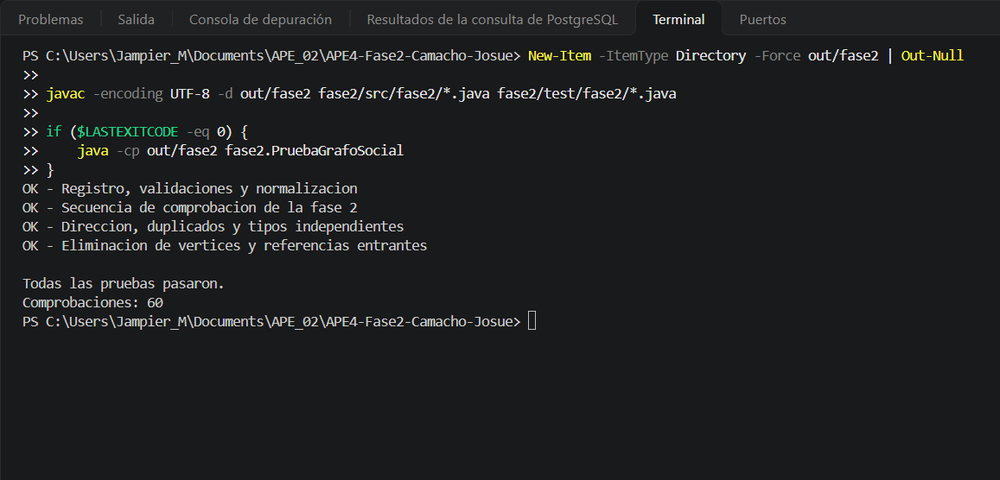
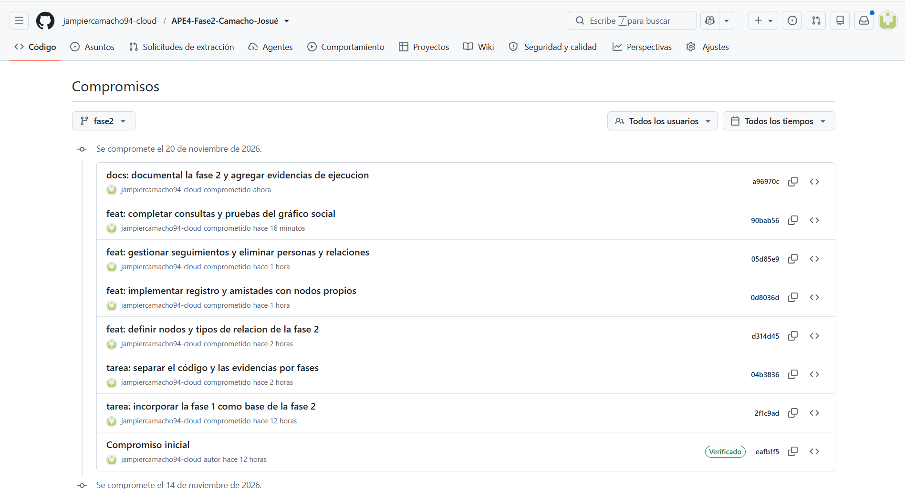

# Evidencias de ejecución — APE 4, Fase 2

**Autor:** Camacho Monta Josue Jampier  
**Asignatura:** Estructura de Datos  
**Modalidad:** Individual

## Compilación y ejecución

Desde la raíz del repositorio, en PowerShell:

```powershell
New-Item -ItemType Directory -Force out/fase2 | Out-Null
javac -encoding UTF-8 -d out/fase2 fase2/src/fase2/*.java fase2/test/fase2/*.java

if ($LASTEXITCODE -eq 0) {
    java -cp out/fase2 fase2.Main
}
```

Cada opción del menú crea una red nueva con los datos iniciales. Las demostraciones son independientes.

## Figura 1. Registro y red inicial



Se registran seis usuarios y cinco amistades. Cada amistad aparece en las listas de ambos participantes. También se rechazan identificadores duplicados y aquellos que contienen espacios o comas.

## Figura 2. Amistades y seguimientos



Nicolás y Emilia siguen a Irene. Se rechazan los seguimientos duplicados, las relaciones consigo mismo y las amistades repetidas.

Una amistad y un seguimiento pueden coexistir entre las mismas personas. Los seguimientos son dirigidos y no incrementan la cantidad de amistades.

## Figura 3. Eliminación de relaciones y personas



Se elimina el seguimiento de Nicolás hacia Irene y la amistad entre Irene y Valentina. Después se elimina a Irene junto con sus relaciones entrantes y salientes.

Quedan cinco usuarios y dos amistades: Nicolás–Paula y Paula–Sergio. El segundo intento de eliminar a Irene devuelve false.

## Figura 4. Consultas y conteos



Irene tiene tres amigos: Valentina, Sergio y Nicolás. Emilia sigue a Irene y no tiene amigos. Los seguidores de Irene son Emilia y Nicolás.

Las consultas de listas de un usuario inexistente devuelven null. El conteo de amigos de un usuario inexistente devuelve -1.

## Figura 5. Pruebas automatizadas



La clase PruebaGrafoSocial superó 60 comprobaciones sobre registro, validaciones, normalización, relaciones dirigidas, duplicados, consultas y eliminación de referencias.

Para reproducir las pruebas:

```powershell
New-Item -ItemType Directory -Force out/fase2 | Out-Null
javac -encoding UTF-8 -d out/fase2 fase2/src/fase2/*.java fase2/test/fase2/*.java

if ($LASTEXITCODE -eq 0) {
    java -cp out/fase2 fase2.PruebaGrafoSocial
}
```

Resultado obtenido:

```text
OK - Registro, validaciones y normalizacion
OK - Secuencia de comprobacion de la fase 2
OK - Direccion, duplicados y tipos independientes
OK - Eliminacion de vertices y referencias entrantes

Todas las pruebas pasaron.
Comprobaciones: 60
```

## Figura 6. Historial en GitHub



La captura muestra el repositorio, la rama fase2 y el historial de commits al finalizar la documentación. Fue tomada antes del commit que incorpora esta imagen.

## Repositorios

- [Entrega de la fase 2](https://github.com/jampiercamacho94-cloud/APE4-Fase2-Camacho-Josue)
- [Repositorio original de la fase 1](https://github.com/jampiercamacho94-cloud/APE4-Fase1-Camacho-Josue)
